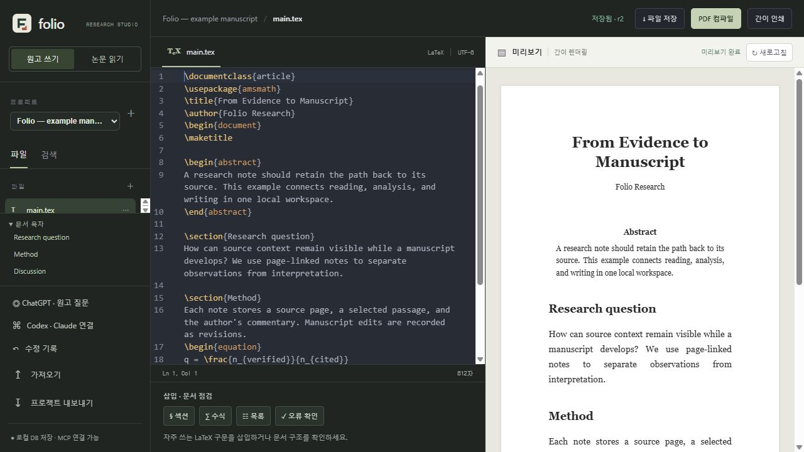
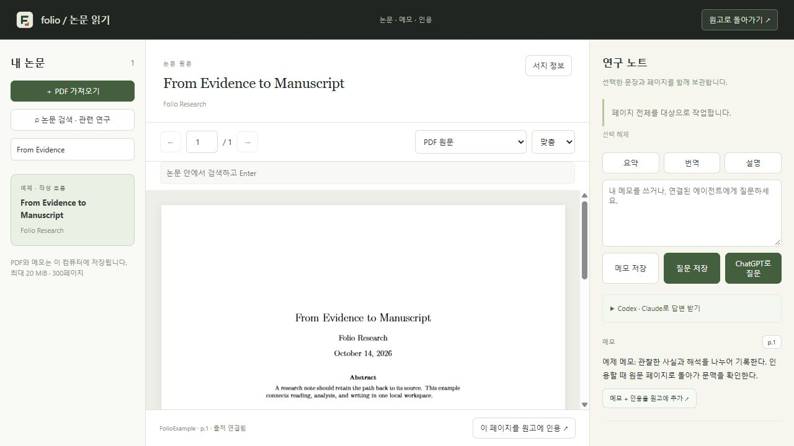

<p align="center"></p>
<h1 align="center">Folio</h1>
<p align="center"><a href="README.md" lang="ko">한국어</a> · <a href="README.en.md" lang="en">English</a> · <strong>日本語</strong></p>
<p align="center"><strong>論文を読み、根拠を残し、LaTeXで原稿を書く。</strong></p>
<p align="center"><a href="https://github.com/sukoji/folio-research/releases/latest/download/Folio-windows-x64.zip"><strong>Windows版をダウンロード</strong></a> · <a href="#start">ブラウザーで起動</a> · <a href="docs/guide.md">ガイド（韓国語）</a> · <a href="CHANGELOG.md">変更履歴</a></p>
<p align="center"><sub>Windows x64 ポータブル版 · ローカルWebアプリ · MIT</sub></p>
<p align="center"><a href="https://github.com/sukoji/folio-research/actions/workflows/ci.yml"></a> <a href="LICENSE"></a></p>


<p align="center"><sub>実際の画面 · LaTeXエディターと原稿プレビュー</sub></p>

論文を読みながら残したメモを、出典と一緒に原稿へ取り込めます。LaTeXエディター、PDFリーダー、参考文献管理、AIへの接続をひとつの作業スペースにまとめました。文書と変更履歴は自分のコンピューターに保存されます。

現在、アプリの表示言語は韓国語です。このページはREADMEの日本語版です。操作するボタンがわかるよう、以下では韓国語のラベルも併記しています。

<a id="start"></a>

## はじめる

<details>
<summary>ブラウザー版とデスクトップ版の違い</summary>

| ブラウザー版 | デスクトップ版 |
| --- | --- |
| ローカルサーバーを起動してブラウザーで開く | Windowsアプリを起動する |
| Node.js 24以上が必要 | NodeとTectonicを同梱 |
| サーバーを終了するとログイン状態が解除される | ログイントークンをOSの機能で暗号化して保存 |
| ZIP読み込み、編集、閲覧、OCR、AI、MCP | 同じ機能を専用ウィンドウで利用 |

デスクトップ版の **브라우저에서 같은 작업 공간 열기**（同じ作業スペースをブラウザーで開く）を押すと、両方の画面で同じデータを使えます。Folioはローカルで動作するアプリで、クラウド上のホスティングサービスではありません。

</details>

### Windowsデスクトップ版

1. [最新リリース](https://github.com/sukoji/folio-research/releases/latest)から **Folio-windows-x64.zip** をダウンロードします。
2. フォルダー全体を展開し、**Folio.exe** を実行します。
3. 新しい原稿を作成するか、既存プロジェクトのZIPを読み込みます。

Windows版はコード署名のないポータブルアプリです。初回のPDFコンパイル時にTeXパッケージのダウンロードが必要になる場合があります。

### ブラウザー版・ソースからの起動

```sh
git clone https://github.com/sukoji/folio-research.git
cd folio-research
npm ci
npm run setup:tex
npm start
```

[localhost:4317](http://127.0.0.1:4317)を開きます。Windowsでは `start.cmd` からも起動できます。ソースからデスクトップ版を起動する場合は、`node node_modules/electron/install.js` でElectronランタイムを取得してから `npm run desktop` を実行してください。

## 最初の論文から原稿の完成まで

| 手順 | 操作 | 得られるもの |
| --- | --- | --- |
| **01 · 取り込む** | Prism・OverleafのソースZIPを読み込むか、新しいプロジェクトを作成します。 | 編集可能な原稿、参考文献、添付ファイル |
| **02 · 読んで記録する** | PDFを開き、必要なページにメモを残します。 | 原文のページに戻れる研究メモ |
| **03 · 引用して書く** | 確認したメモを原稿に引用し、編集を進めます。 | 出典リンクとBibTeXを含む原稿 |
| **04 · 書き出す** | PDFをコンパイルし、プロジェクトのZIPを保存します。 | 提出用PDFと、編集を続けられるソース |

## 既存の原稿を取り込む

PrismやOverleafで **LaTeXソースのZIP** を書き出し、Folioの **가져오기**（インポート）で選択します。

- `.tex`、`.bib`、スタイルファイル、図、フォントをまとめて読み込みます。
- サブフォルダーの構造を保持します。全ファイルを包む共通の外側フォルダーがある場合は、1階層だけ取り除きます。
- 既存のプロジェクトを上書きせず、新しいプロジェクトを作成します。
- 対応していないファイルは、読み飛ばしたファイルとして一覧で知らせます。書き出しにもZIPを使えます。

コンパイラーはTectonicです。Overleafのコンパイラー設定、コメント、共同編集履歴は移行されません。外部プログラムや特定のフォント・パッケージに依存する文書は、修正が必要な場合があります。[対応形式と制限（韓国語）](docs/guide.md#import-and-compile)

## 読む → メモする → 引用する



**논문 읽기**（論文を読む）でPDFを開きます。文章を選んで要約・翻訳・説明を依頼したり、メモを残したりできます。図について質問する際には、表示中のページ画像も送信できます。内容を確認したメモは **메모 + 인용을 원고에 추가**（メモと引用を原稿に追加）で取り込みます。原稿の目次の下にある出典リンクから、元のページに戻れます。

| 作業 | 機能 |
| --- | --- |
| 執筆 | LaTeXの構文色分け、検索・置換、補完、括弧の対応表示、折りたたみ、文書の目次 |
| 閲覧 | PDF原文、テキスト選択、本文検索、拡大表示、出典付きメモ |
| スキャン | テキストを含まないページの英語・韓国語OCRをローカルで実行 |
| 文献探し | Crossref検索、タイトルに基づく関連論文、読む予定の文献リスト |
| 引用 | ページ単位の引用、BibTeXの追加、メモと原文の紐づけ |
| 仕上げ | TectonicによるPDFコンパイル、エラーログ、ZIP書き出し |
| エージェントとの編集 | Codex・Claude CodeのMCP接続、変更履歴、古いリビジョンからの上書き防止 |

## AIへの接続を選ぶ

**ChatGPT:** **ChatGPT · 원고 질문 → Continue with ChatGPT** を選択します。公式ログイン画面でアクセスを許可した後、**모델 새로고침**（モデル一覧を更新）を押します。アカウントとモデルごとのアクセス権限・利用上限が適用されます。回答を確認してから、コピーまたは研究メモへの保存を行ってください。

**Codex / Claude Code:** 普段使っているエージェントをMCPで接続し、文書の読み書きや論文についての質問への回答を依頼できます。編集には現在のリビジョン番号を渡します。変更が競合した場合、Folioは上書きを拒否します。

→ [ログイン、MCP設定、データの保存場所（韓国語）](docs/connections.md)

## 現在の制限

簡易プレビューが対応するのはLaTeXの一部の構文です。提出するPDFは **PDF 컴파일**（PDFコンパイル）で確認してください。OCRの結果は原文との照合が必要です。関連論文の一覧は書誌情報の検索結果です。複数ユーザーによるリアルタイム共同編集、クラウド同期、元のPDFレイアウトを保持した翻訳には、現在対応していません。

ChatGPT接続は公式のOAuthフローを使っています。認証コールバックと応答ストリームの処理テスト、およびログイン画面は確認済みです。実際のアカウントでの認可と推論の完了は、まだ検証していません。

## よくある質問

<details>
<summary>AIのアカウントは必要ですか？</summary>

原稿の編集、PDF閲覧、メモ、引用、OCR、コンパイルはAIへのログインなしで使えます。AIの回答が必要なときにChatGPTまたはMCPエージェントを接続してください。

</details>

<details>
<summary>文書はどこに保存されますか？</summary>

ソースから起動したWeb版はプロジェクト内の <code>data/</code>、Windows版は <code>%APPDATA%/folio-agent-workspace/workspace/</code> に保存します。バックアップする際はFolioと接続中のエージェントプロセスを終了し、データフォルダー全体をコピーしてください。プロジェクトのZIPには論文ライブラリーや変更履歴は含まれません。

</details>

<details>
<summary>外部には何が送信されますか？</summary>

ChatGPTへの質問では、選択した原稿や論文の文脈、質問に含めたページ画像をOpenAIへ送信します。文献検索の検索語はCrossrefに送信します。MCPエージェントのデータ処理は、そのツールの設定に従います。初期インストールとTeXパッケージの取得にもネットワークを使います。

</details>

## 開発

```sh
npm run build:editor   # CodeMirrorのブラウザー用バンドル
npm run check         # 構文チェック
npm test              # 保存、インポート、OCR、MCP、OAuth、推論応答処理のテスト
npm run build:desktop # 現在のプラットフォーム向けポータブルアプリ
```

`FOLIO_TEST_TEX=1` を設定すると、実際のPDFコンパイルもテストします。テスト対象はWindowsとLinuxです。デスクトップ配布版の動作確認対象はWindows x64です。

## ドキュメントと貢献

| 知りたいこと | ドキュメント |
| --- | --- |
| 編集、閲覧、OCR、コンパイルの使い方 | [ガイド（韓国語）](docs/guide.md) |
| ChatGPTログイン、MCP設定、保存場所 | [接続ガイド（韓国語）](docs/connections.md) |
| バージョンごとの変更点 | [変更履歴（英語）](CHANGELOG.md) |
| 同梱ライブラリーとランタイム | [ライセンス表記](THIRD_PARTY_NOTICES.md) |

不具合は、アプリのバージョン、OS、再現手順を添えて [Issues](https://github.com/sukoji/folio-research/issues) に報告してください。原稿に関する問題には、公開できる小さな再現用サンプルを使ってください。ドキュメントや翻訳の修正もプルリクエストで受け付けています。READMEの内容を変更する際は、韓国語・英語・日本語版の内容を揃えてください。

---

Folio独自のコードは [MITライセンス](LICENSE) で公開しています。同梱ライブラリーとランタイムのライセンスは [Third-party notices](THIRD_PARTY_NOTICES.md) に記載しています。FolioのSVGシンボルはこのリポジトリのために制作したもので、同じライセンスで利用できます。
